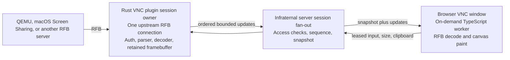

<!-- Role: product design and implementation plan for infraternal's first-party RFB client and canvas window. -->

# VNC window design and build plan

**Issue:** [kayg/infraternal#223](https://git.kayg.org/kayg/infraternal/issues/223) 
**Research snapshot:** 2026-10-15 
**Scope:** design and plan only; this lane adds no product code.

## Settled choices and working proposal

D282 settles the main choice: infraternal writes and tunes its own RFB client; it does not embed a third-party RFB library. A VNC connection is a canvas window for any supported VNC target, not only a fallback for native capture. The server-side session owner keeps one upstream connection and the current framebuffer, then serves viewers through the existing relay path [D104, D200, D221, D282].

The working decode proposal follows D88: implement the same bounded RFB rectangle codecs in Rust and TypeScript, share golden vectors, and compare the two with differential tests. Rust decodes every accepted update into the retained framebuffer. Each browser decodes the ordered updates in an on-demand worker and paints its own canvas. This spends CPU on a second decode, but keeps the viewer stream compact and leaves the Rust owner able to send an immediate snapshot to a late or repaired viewer. The active QEMU run has not measured this complete pipeline; the build plan measures it against a server-decoded pixel-update candidate before the owner locks the final pipeline.

The Rust RFB state machine, upstream session lifecycle, bounds, fan-out and input authority are ours. Compression or JPEG primitives are not selected here: first inspect what the binary already contains, then bring any new decoder candidate to the owner with measured latency, memory and D243 size cost. The TypeScript decoder stays in a worker with no WASM bridge [D88].

## 1. What feels seamless

Screens 5 combines saved connections and automatic discovery with a live toolbar, separate touch and trackpad behavior, adaptive quality, display selection, shared clipboard, file transfer, and a private remote-screen option. Its documentation is useful as a behavior reference. Some items are Mac-specific: Curtain Mode requires Remote Management and does not work with macOS Screen Sharing; adaptive quality is documented only for Mac connections; file transfer is documented for Mac-to-Mac [S1–S9].

| Screens 5 behavior | What the person feels | RFB reality | Infraternal canvas design |
|---|---|---|---|
| Connect and reconnect without a new setup ritual | A saved machine opens promptly; a browser or network interruption returns to the same screen [S1]. | RFB itself is a live byte-stream session. It has no durable session, browser resume, or retained-screen contract. Proxmox access also has a short-lived console ticket. | The Rust session owner opens one upstream RFB connection per target and keeps it across viewer detach/reconnect. The server retains a sequence-numbered framebuffer snapshot and fans updates to viewers. A returning viewer first paints the cached image, then catches up from its sequence. If the upstream itself ended, the owner reopens it, obtains fresh Proxmox authorization, and presents explicit reconnect state. This is D104/D259 behavior. |
| Adaptive quality | Motion stays responsive on a weaker link; detail sharpens as the link recovers [S3]. | Standard RFB rectangle selection is negotiated for the upstream session. Tight's JPEG quality control is an extension; a target may ignore it. QEMU's standard VNC path does not offer H.264 RFB encoding [S3, S9, S10]. | Offer `Auto`, `Lossless`, and `Motion` as remembered per-target settings. `Auto` can change Tight/JPEG quality only when the server proves support, with hysteresis from measured transfer backlog and dirty-rectangle rate. Settled text returns to lossless. Until quality thresholds pass perf-VM tests, `Auto` remains conservative and the chosen quality is session-wide because viewers share one upstream. No per-viewer quality promises in v1. |
| Curtain Mode | Someone near the remote Mac sees a covered/locked screen while the remote viewer keeps working [S9]. | Not a standard RFB capability. Edovia documents that it requires macOS Remote Management, not Screen Sharing [S9]. | Do not show a generic VNC curtain toggle. Later, expose it only when an authenticated, tested host capability confirms that the source can enable and verify it. A local-input pause or an infraternal window lock is not a curtain. |
| Trackpad and touch modes | Trackpad mode moves a cursor precisely; touch mode places it at the tap. Scrolling feels intentional [S4]. | RFB pointer messages use absolute framebuffer coordinates and button bits. Wheel support is commonly represented as discrete button events, so it cannot carry arbitrary smooth pixel deltas [S9]. | Phone default is D200 V4 trackpad mode: maintain a local virtual cursor from relative finger movement, then send absolute framebuffer coordinates. A tap clicks; two-finger movement accumulates into wheel steps without discarding fractional remainder. Direct-touch mode maps a tap to the corresponding remote pixel. Provide one switch between modes and use existing shared controls. |
| Keyboard layout and modifiers | Hardware and soft keyboards enter the intended text and shortcuts on different guest operating systems [S6]. | RFB key events carry keysyms; QEMU's ExtendedKeyEvent adds physical scancodes. Browser dead keys may arrive as `key="Dead"`, without enough information to infer the accent from `keydown` alone [S11–S13]. | For hardware keyboards, preserve `code`, `key`, and modifier state; send QEMU scancode plus keysym when negotiated, otherwise send a layout-aware keysym. For the phone keyboard, capture committed composition text in a real input surface and send the completed Unicode text path, rather than fabricating one keydown per character. The accessory row supplies Esc, Ctrl, Alt/Option, Meta/Command, arrows and sticky modifiers. Add target-OS mapping tests; do not silently reinterpret AltGr. |
| Clipboard sync | Copy on either side and paste on the other, with a deliberate manual action when automatic sync is off [S7]. | Base `CutText` is text-oriented and has historical encoding limits. ExtendedClipboard can negotiate UTF-8 and extra formats, but both peers must support it [S9, S15]. Browser clipboard APIs also require user activation in some cases. | Start with explicit Send and Get text actions. Use UTF-8 ExtendedClipboard when both sides advertise it; retain the base text fallback and explain its limits. Automatic sync is opt-in per target, is gated by browser permission, and never logs contents. Images and rich text are later capability-tested formats. |
| File drag and drop | A file can be moved through the remote desktop window without finding a separate transfer tool [S8]. | File transfer is not universal RFB behavior. The community protocol describes optional file-transfer messages, and QEMU source has ExtendedClipboard file-format flags, but this is peer-specific [S9, S10]. | Add drag/drop only when the peer negotiates a supported file-transfer or file clipboard extension and the transfer is bounded. Prefer the explicit file-transfer action where supported. The toolbar offers no disabled-looking promise on generic VNC peers. Validate both directions and progress/cancel behavior in a later slice. |
| Multiple displays | Switch to a monitor or view the whole desktop arrangement [S5]. | RFB can describe several screen viewports inside one framebuffer with ExtendedDesktopSize; framebuffer updates still address the shared surface [S9]. Many servers provide only one surface. | One VNC window and one upstream session can select a reported display or the combined layout. If the peer exposes no display list, show its full framebuffer and keep pan/fit controls. Never open one upstream connection per monitor. |
| Retina and HiDPI | Text and edges remain sharp at the window's displayed size, and full screen uses the available detail [S5]. | `ExtendedDesktopSize` and `SetDesktopSize` are optional and inconsistent across servers. If the target cannot resize, the client must scale or pan its existing image [S5, S9]. | Follow D200 V3: request the settled canvas box × device density, capped at 4,194,304 pixels. Request target resize only when the saved setting permits it and the peer confirms support; otherwise preserve target resolution and offer fit/1:1 pan. Full screen requests one settled resize. Browser zoom does not repeatedly resize the guest. With multiple viewers, the controller owns source sizing; other viewers fit the shared frame. |
| Remember settings per host | Reopening a machine restores a familiar display, quality, and input mode [S1, S2]. | RFB does not store client preferences. | Save non-secret settings against the host and VNC target: selected display, source resize preference, fit/1:1, quality, trackpad/touch mode, clipboard permission and last window placement. Use the existing canvas settings path. Credentials stay in the existing secret store and never appear in a URL, log or setting export. |
| Toolbar and full screen | Controls stay close when needed and out of the way on a phone; full screen does not start another session [S2]. | Toolbar is client UI. Full screen itself does not require an RFB reconnect. | Keep one shared window header/toolbar and existing shared pills, buttons and key controls from `packages/ui`. On phones, keep input, display, clipboard, quality and control actions reachable without covering the remote pointer target. Full screen expands the same canvas window and preserves its session. |
| Screens Connect-style discovery | Nearby and remote computers appear in one library with no address hunting [S1]. | RFB has no discovery or rendezvous service. | Use infraternal host inventory and mesh reachability. D282's Proxmox node component discovers local VMs/containers and cluster nodes; the infraternal agent starts the local VNC console. A node without an infraternal agent uses the Proxmox API path. Generic VNC targets remain saved/manual host records. The browser never dials the target. |
| Observe/control and multi-viewer handover | Other people can watch; one person visibly takes control at a time [S2]. | RFB's shared flag is not an infraternal viewer permission or input lease. | Reuse D200 V5 and the existing Rust desktop session pattern: five viewers maximum per session, one control lease, explicit one-tap handover, visible controller state, and key/button release before ownership changes. The holder checks access immediately before forwarding input. |

## 2. noVNC and Proxmox console annoyances to design out

These are reported cases, not claims that every noVNC or Proxmox version has the same defect. The fixes below are design requirements and later test cases.

| Reported annoyance | Evidence | Design response |
|---|---|---|
| Wrong keyboard layout, broken modifiers, or dead keys dropping the accent | Proxmox reports describe German Z/Y and symbol mismatches, French dead keys producing the base letter, and an iPadOS virtual-keyboard special-character issue. A current noVNC report records Android Gboard mapping `@` to `2`; W3C's UI Events discussion documents missing dead-key detail in `KeyboardEvent` [S11–S13]. | Keep physical-key and committed-text paths separate. Use scancode+keysym only when the peer advertises the QEMU extension; use the browser's committed composition text for soft keyboards; include German, French, and AltGr cases in the conformance suite. Show the active input mode and a clear unsupported state instead of typing a wrong character silently. |
| Mobile keyboard or touch controls are missing or hard to reach | noVNC issue #1757 reports a missing mobile keyboard control; issue #856 reports virtual keyboard characters not reaching the remote session [S12]. | Phone input is designed into the VNC window from its first slice: always-reachable keyboard action, accessory keys, explicit trackpad/touch switch, and tested focus retention when a modifier is tapped. |
| Copy/paste is absent, lossy, or confusing | A Proxmox forum user could not copy/paste through the noVNC console; noVNC clipboard behavior depends on browser permission and peer extensions [S14, S15]. | Provide named Send/Get actions, distinguish local clipboard permission from remote clipboard capability, use ExtendedClipboard UTF-8 when negotiated, and say when a peer only supports the older text path. File transfer is a separately negotiated capability. |
| Scaled desktop looks blurry while 1:1 looks crisp | noVNC issue #1469 records a blocky/blurry Windows image in local scaling that became crisp with scaling disabled [S12]. | Negotiate a pixel size close to the displayed canvas when the target allows it. When it does not, offer fit and 1:1 pan as explicit modes; do not claim that scaling creates source detail. Use device density, a single canvas transform, and pixel-diff tests for resizes. |
| Console freezes, reconnects repeatedly, or returns blank | Proxmox reports a console freezing until it is reopened and periodic reconnects when a proxy times out an idle WebSocket. A noVNC H.264 review records a decode-error path that could stop the framebuffer request loop [S12, S16]. | Keep the target session and last framebuffer outside the browser tab. Use one reconnect state machine with bounded retries and a visible error after it gives up. Sequence every update; repair a gap with a full snapshot. A decoder error must release its worker and request repair without wedging input or transport. |
| Reconnection creates a new task or loses the session's current screen | Proxmox issue reports describe repeated console starts after inactivity and a console session that could remain blank after closing/reopening a viewer [S16]. | Browser close only detaches its viewer. The Rust holder retains the one upstream session and current framebuffer; a new viewer gets an atomic snapshot/update boundary. Only a target-side disconnect starts a new upstream connection. |
| Cursor is hard to see, and gesture behavior changes by device | noVNC issue #1173 asks for a more visible remote dot cursor; #2072 reports incorrect Firefox cursor rendering [S12]. | Decode the server cursor pseudo-encoding into a separate overlay with its hotspot preserved. Keep pointer scale tied to the image rect, not the enclosing window, and test at DPR 1, 2 and 3. |
| Memory grows while a desktop is idle or hidden | noVNC issue #2075 reports Chromium image-cache/RAM growth [S12]. | Bound framebuffer and decode queues. Hidden/off-screen windows detach and stop receiving updates; on phones they release the worker and canvas surface immediately, matching the app-window lifecycle. One unchanged frame schedules no paint work. |
| Opening a console requires ticket/cookie details in browser plumbing | A Proxmox forum integration report records a failed external noVNC WebSocket until the Proxmox auth cookie was also carried [S16]. | The infraternal agent launches the local `qm vncproxy` process pipe for the VM's owner node and authenticates the RFB side there. Browser traffic uses the existing signed-in infraternal relay. Tickets stay in short-lived memory, never in a browser URL, argv or log. |

## 3. Client architecture

### Rust holder and fan-out

- The infraternal agent owns the QEMU/Proxmox upstream when it is installed on the target node. For Proxmox it discovers the VM, runs `qm vncproxy` locally, and consumes the process pipe. The `vncproxy` process must run on the VM's owner node; remote cluster-node startup still needs a real-cluster functional check. A deployment without the infraternal agent can use the D282 Proxmox API path. Do not install Proxmox as part of this design lane [D282, S17].
- One Rust session registry entry owns one upstream RFB connection per target. It negotiates an RFB version, security type, pixel format and encoding list; sends input/resize/clipboard messages only for the current controller; and keeps the canonical framebuffer. The server applies existing view/control access checks and relays updates. There is no browser-to-target socket and no RFB handshake credential forwarded to a viewer [D8, D10, D104].
- Reuse the app-window fan-out and lifecycle shape, not its H.264 wire type: `crates/plugins/desktop/src/session.rs` at `origin/app-windows-ship` (`bdb0ffc509c2c0f406b5c5467a522d56be04892f`) keeps a shared latest frame, limits viewers to five, and fences control through a lease. `apps/tracer/src/canvas/appwin/stream.ts` attaches/detaches viewers and requests repair; `decode.worker.on-demand.ts` bounds the decoder queue and paints off the UI thread. For VNC, a missed sequence needs a full framebuffer snapshot rather than a video IDR.
- Each published update has a monotonically increasing session sequence. A snapshot is stamped at sequence N; the server atomically queues only updates after N. Fan-out shares immutable update bytes. Per-viewer queues are bounded; if a viewer falls behind, it stops applying deltas and requests a fresh snapshot rather than blocking the upstream or displaying a corrupted framebuffer. A viewer attaches on demand; when its window goes off-screen, it detaches and receives no further updates. The target session and server-side snapshot stay alive [D104, D200 V7, D88].

### Browser TypeScript decoder and canvas

The VNC code is dynamically imported only when a person opens a VNC window. It implements the same RFB update and rectangle codec rules as Rust, runs in a dedicated worker, and paints a single canvas surface. The main thread handles canvas-window lifecycle, input, toolbar, focus and permission prompts. It does not parse upstream security or connect to the VNC target. No TypeScript code for the window is in the critical path [D88, D188].

Reuse the existing canvas `SessionBinding`, stream adapter over the page's single `MuxConnection`, shared `packages/ui` components, the app-window size and pointer geometry helpers, and the shared input-control lifecycle. A VNC window kind gets its own binding/worker and state but no duplicate button, pill, sheet, toast, keyboard row or spring implementation [D160, D200 V7, D282].

### Where each encoding is decoded

For image encodings, the Rust session owner decodes every update once into its retained framebuffer, and the TypeScript worker independently decodes that same ordered update for its browser canvas. This gives the holder enough state to repair late viewers and avoids sending an uncompressed full copy for every live rectangle. The second decode is a known CPU cost and must pass the perf comparison before the pipeline is locked.

| Encoding or extension | First implementation order | Rust holder | Browser TypeScript worker / UI | Why and constraints |
|---|---:|---|---|---|
| Raw | 1 | Validate rectangle bounds and pixel format; copy rows into canonical framebuffer. | Copy pixel rows into the worker's framebuffer and paint the changed rectangle. | Simplest correct fallback and the golden baseline for every codec. QEMU and every compatible RFB server can offer it. A full 1280×800 32-bit frame is 4,096,000 bytes before transport overhead. |
| CopyRect | 2 | Copy from source rectangle to destination in the canonical buffer. | Apply the same overlap-safe copy to the canvas backing buffer. | Cheap moving-window and scrolling updates; ordering matters. Add after Raw so source/destination correctness is covered. |
| ZRLE | 3 | Bound the compressed stream and tile/run counts, inflate, decode palette/packed/RLE tile modes, then update the canonical buffer. | Mirror the decoder in TypeScript with the same golden vectors and size limits. | QEMU supports it; it is a useful lossless bandwidth option. The inflate primitive must reuse an existing compatible implementation or be brought to the owner with size and speed measurements [S9, S10]. |
| Tight, including JPEG | 4 | Decode Tight control/filter/palette/copy streams and the JPEG subencoding into canonical pixels. | Decode Tight in the worker; use a browser-native image decoder for JPEG bytes and draw only after the full rectangle validates. | QEMU advertises Tight. JPEG can reduce moving-scene traffic but softens text; prefer lossless mode after motion settles. Rust needs a JPEG decoder for the retained framebuffer, so do not enable this until the existing dependency path and static size cost are measured and reviewed [S9, S10]. |
| Hextile | 5, only if needed | Decode bounded tiles if a named first-wave server needs it. | Keep the matching TypeScript decoder behind the same feature. | Do not pay the code and test cost until QEMU/macOS/Linux samples show that first-wave targets need it. |
| Cursor and PointerPos pseudo-encodings | 1 with Raw | Parse cursor shape/hotspot and pointer position; neither modifies framebuffer pixels. | Draw a separate cursor overlay and position it with the original hotspot and scale. | Prevents pointer movement from retransmitting image rectangles and makes the cursor visible while observing. |
| ExtendedDesktopSize / SetDesktopSize | 4 | Parse the server's framebuffer and screen layout; request a new size only after user preference and peer capability allow it. | Resize the canvas backing surface and map the view's display selection. | Optional and server-specific. Never assume a resize request was accepted. |
| QEMU ExtendedKeyEvent | 5 | Encode the negotiated extended message with scancode, keysym and down/up state. | Map `KeyboardEvent.code`, committed text and modifiers to the extension; fall back to ordinary keysyms if absent. | QEMU-specific; it addresses physical keyboard mapping but does not replace the soft-keyboard text path. |
| ContinuousUpdates | 5 | Negotiate only if advertised; pause/enable it with visibility state. Otherwise keep one incremental request outstanding. | No browser protocol state beyond receiving ordered updates. | QEMU does not implement it in the reviewed source; the ordinary incremental request loop must work first [S10]. |
| Fence | 5 | Parse and answer supported fence requests as an ordering barrier. | No image decoding. | Optional; QEMU does not implement it in the reviewed source. Do not wait for it to show a frame [S10]. |
| LastRect | 3 | Treat the pseudo-rectangle as the end of this update and stop parsing rectangle bodies. | Apply the same update boundary. | Small compatibility item that makes rectangle count parsing explicit; never draw it. |

RFB messages are byte streams, not WebSocket messages. The holder parses complete bounded messages before publishing. A single 4-megapixel raw update is 16 MiB, larger than one current mux frame, so the VNC plugin must fragment updates into bounded transport frames and reassemble them against a byte cap and deadline. A partial/corrupt update is discarded as a unit; it cannot be spliced into the next sequence. The new plugin wire shape is additive and must not change a frozen core frame [D12, D88; `contracts/wire.md`].

### Security types and connection order

The client accepts only security types it explicitly implements. RFB's registered values are 1 None, 2 VNC Authentication, 19 VeNCrypt and 30–36 Apple-assigned [S9, S18]. The order below is implementation order and a closed allowlist, not permission to downgrade an untrusted connection.

| Order | Security type | Use |
|---|---|---|
| 1 | None (1) | Only for an infraternal-agent-owned local Unix socket or equivalently isolated loopback endpoint whose OS access and VM binding are verified. Never accept `None` from an arbitrary network endpoint. |
| 2 | VNC Authentication (2) | Proxmox `qm vncproxy` first-wave path. The process receives a short-lived console ticket/password in infraternal agent memory; use it for the VNC challenge and drop it when the pipe closes. Never put it in argv, a browser URL or logs. VNC authentication alone is not transport encryption, so this path stays on the node-local process pipe [D282, S17]. |
| 3 | VeNCrypt (19) | General encrypted VNC path after certificate verification is implemented. Start with X509Vnc (261) and X509Plain (262); allow X509None (260) only when a separate identity/access check authenticates the endpoint. Reject Plain (256), TLSPlain without verified identity, and unauthenticated TLS modes. VeNCrypt subtypes are enumerated in the community specification [S18]. |
| 4 | Apple Remote Desktop types | Add macOS compatibility after versioned macOS tests. Implement type 30 as the legacy compatibility baseline, then research and test types 33, 35 and 36. A current LibVNCServer engineering report says its author tested 33/35/36, that 35 is Kerberos-based, and that 34 is deferred; this is implementation evidence, not an Apple protocol specification. Do not silently select an unknown Apple-assigned type or claim that type 30 encrypts the whole RFB session [S19, S20]. |

Apple's own Remote Desktop security documentation describes authentication and encryption as version- and task-dependent. The first Apple build slice must record the offered security list, target macOS version, selected type, and whether the framebuffer/input channel is encrypted. The exact ordering among newer Apple types remains open until there is a public spec or measured interop against a versioned macOS sample [S19, S20].

### Deliberate first-wave limits

- No RFB library dependency, no H.264 re-encoding stage, and no WASM bridge. QEMU/Proxmox does not offer standard H.264 RFB, and server re-encoding adds a new codec, host CPU work and a second failure/recovery path. Measure that candidate later only if browser RFB decoding misses the perf target [D88, D282, S10].
- Raw, CopyRect and ZRLE lead. Tight/JPEG follows only after the Rust JPEG decoder and static binary cost are known. Hextile is conditional on a real first-wave server requiring it.
- Initial clipboard support is text; rich formats and file-transfer extensions are capability-gated follow-ups. Generic peers do not receive a fake file-transfer button.
- Curtain Mode is not claimed for generic VNC. Apple-private control/auth extensions are version-tested before their controls appear.
- One upstream session means one source resolution and one session quality. The active controller owns resize and quality changes; watchers scale the shared picture. This avoids viewers repeatedly resizing each other's guest.
- No audio in the VNC window. The base RFB protocol does not carry it [S9].

## 4. Size, memory and performance budgets

| Area | Budget or target | Basis and scale |
|---|---|---|
| Critical browser path | **0 bytes of VNC code.** The VNC plugin and worker load only after opening a VNC window. | D188 on-demand class. Confirm from the production bundle graph, not a dev build. |
| On-demand browser chunk | Working target: **≤128 KiB gzip** for VNC parser/decoder/worker code, excluding existing shared canvas/UI code and browser-native decoders. | D188 requires a separate measured deferred budget but publishes no VNC figure. This is a proposed cap to verify in the first code-split build; if the real build misses it, measure and bring the cost to #223 before increasing it. |
| Static Rust binary | **No net growth vs the same-recipe merge base**, and no breach of D243's x86_64 22,204,304-byte / aarch64 19,638,744-byte caps. If the RFB code grows the executable, remove at least that many bytes elsewhere or get an explicit owner exception before implementation. | D243 is a hard cap, not a growth allowance. The prior report-only run at `2ce4930dd` measured x86_64 22,277,392 bytes (+73,088 over cap) and aarch64 19,705,112 bytes (+66,368); that source diff added no executable code. The full gate on this branch must remeasure its own baseline. |
| Retained pixels | One canonical **16 MiB** buffer per 4,194,304-pixel VNC session; no per-viewer copy on the Rust holder. At 50 sessions this is **800 MiB** before parser/queue/scratch memory. | Run the 50-session scale case on the 4-vCPU/7-GB perf VM (D256). Report canonical-buffer bytes separately from decoder scratch and process RSS. |
| Browser surfaces | At most **16 MiB per 4-megapixel visible canvas**; release hidden surfaces and workers on phones immediately. | Four visible maximum-size windows are a 64 MiB surface floor per browser before decoder/GPU copies. Measure actual browser heap and graphics memory; do not multiply the canonical host buffer by five viewers. |
| Viewer fan-out | **Five viewers maximum per session**, one controller, bounded per-viewer queues. | Reuse current app-window session cap until a scale test justifies a different value. A slow viewer is repaired from a snapshot rather than stalling the target. |
| Input-to-pixel | Local perf-VM profile, RTT ≤10 ms, 60 Hz target: **p95 ≤50 ms, p99 ≤80 ms** from input dispatch to the first changed canvas pixel. For remote profiles report measured RTT separately; target is RTT + 50 ms p95. | New VNC window budget; D41's terminal keystroke budget is not a VNC framebuffer budget. Record input type and server update rate. |
| Warm join-to-first-full-frame | **p95 ≤300 ms** for a 1280×800 QEMU session already held by the Rust owner on the perf VM. Remote profile target is measured viewer RTT + 300 ms. | Measure first pixel and complete first full frame separately. The current issue run's first-pixel figure is 817.08 ms; full-frame join was not measured. |
| Reconnect | Show the locally held last picture within one display frame; after a resumable path returns, bring it current within RTT + 50 ms. A fresh network path uses D267's three-RTT + 50 ms session budget. | Preserve D259/D267; no new VNC exception. The Rust holder and browser's existing copy each retain the last frame. |
| Idle traffic and work | **0 RFB framebuffer-update bytes over 8 seconds** with an unchanged screen. No browser paint, decode worker work, or active viewer stream while the VNC window is hidden. Report transport health pings separately. | The issue's QEMU run already measured 0 RFB bytes/8 s with one and five viewers; retain this as a regression gate. |

The latest attached QEMU run on #223 used QEMU 10.0.13, Alpine 3.24.2, 1280×800, 4 vCPU and Chromium Headless Shell 153.0.8010.12 on the perf VM. One-viewer idle for 8 s: 0 RFB bytes, QEMU CPU 6.5%, Chromium aggregate CPU 13.25%, RSS 750.45/551.27 MiB. Five-viewer idle for 8 s: 0 RFB bytes, QEMU CPU 6.625%, Chromium aggregate CPU 38.5%, RSS 759.29/1,304.13 MiB; page heaps 10.0–17.1 MB. First-pixel join was 817.08 ms for the first viewer and 748.55–896.93 ms for four later viewers. Active input-to-pixel p50/p99 and complete-frame join remain unmeasured; a 755-byte scroll interval coincided with delayed terminal typing and was excluded. These figures are the baseline, not proof that the proposed pipeline meets the new targets [#223 perf-VM run comment].

Every timing, CPU, memory or bundle-size result for implementation slices runs on the perf VM under its lock, with target machine, QEMU version, browser version, load average, viewer/session count and active workload recorded. Build on the build host; do not use its timings as evidence. Compare one, five and fifty sessions where applicable.

## 5. Conformance corpus

No public sanitized QEMU or macOS RFB recording file was located in this research pass. A public recording utility exists, but its repository is a recorder, not a ready-to-use sample corpus [S21].

- **QEMU:** create a deterministic guest/test pattern, run QEMU with a VNC Unix socket and separately with a loopback TCP port, and record representative RFB sessions for Raw, CopyRect, ZRLE, Tight/JPEG, resize, cursor, clipboard and server restart. The test pattern uses fixed colors, text, scroll regions and cursor movement; it contains no host/user data. Keep the normalized transcript as a normal test fixture because the parser tests read it. Raw packet captures, screenshots and logs remain outside the checkout and are attached to the issue under D262.
- **macOS:** until a public sanitized session appears, use synthetic byte streams for version/security negotiation, ServerInit, resize and framebuffer updates. Synthetic authentication fixtures use test-only values. Do not copy a real user's framebuffer or credentials into the repository. A versioned macOS functional sample is a later test only if it can be captured from a disposable test account and reviewed for private content.
- **Shared checks:** run identical rectangle fixtures through Rust and TypeScript, compare the canonical pixels and cursor/display metadata, split messages at every possible transport boundary, and test declared lengths, compressed output sizes, tile totals and rectangle bounds before allocation. Store deterministic golden vectors in the VNC plugin's test corpus; run property tests over dimensions, tiling, clipping and stream fragmentation.

## 6. Build slices and gates

Each implementation slice is a separate atomic commit. Run the touched Rust/TypeScript tests and crate gates for each slice, `scripts/verify iterate` between milestones, and `scripts/verify fast` once on the final branch head. All time/CPU/memory/frame measurements below run on the perf VM; functional browser tests use a unique `TRACER_TEST_PORT`.

| Slice | Work | Tests and compatibility | Perf-VM measurements |
|---|---|---|---|
| 0. Contract and harness | Add the VNC plugin/action/wire contract, on-demand window seam, QEMU fixture launcher and deterministic RFB sample corpus. Keep the plugin removable at build time and switchable at runtime with no listener/task while off [D198]. | Contract review; shared Rust/TS golden-vector harness; byte-boundary, declared-length, pixel-format and rectangle-limit property tests. QEMU Unix socket and loopback TCP smoke connection. | Baseline connect/first-pixel/full-frame timings, 1/5-viewer idle bytes, per-session RSS and browser bundle graph. Record machine/load and the build SHA. |
| 1. Handshake, auth and Raw | Rust RFB 3.3/3.7/3.8 negotiation, allowed None/VNC Auth paths, 32-bit 24-depth pixel format, one upstream session, canonical framebuffer, sequence/snapshot boundary, Raw decoding in Rust and TypeScript. | Synthetic server variants for version negotiation and short reads; real QEMU Unix socket/TCP; snapshot pixel vectors; close/reopen viewer without closing the target. | Cold target connect; warm join-to-first-full-frame; Raw bytes/frame; Rust CPU/RSS at 1, 5 and 50 held sessions; input-to-pixel baseline. |
| 2. CopyRect, cursor and repair | CopyRect and cursor pseudo-encoding; bounded shared fan-out; gap detection and full-snapshot repair; visible/hidden attach behavior. | Overlapping CopyRect vectors, cursor hotspot and DPR tests, deliberately paused viewer then snapshot repair, one-controller handover releases all pressed keys/buttons. | One/five viewers while scrolling/moving windows; snapshot repair duration/bytes; p50/p95/p99 input-to-pixel; zero RFB bytes in 8-second idle. |
| 3. ZRLE and Tight/JPEG | ZRLE in both codecs; measure JPEG decoder candidates already in the stack before choosing one. Tight/JPEG follows only after the Rust retained-frame path and D243 cost are approved. Hextile is added only if the recorded target matrix needs it. | Golden vectors for tile modes, bounds checked before allocation, Rust/TS pixel equality, text edge and JPEG quality checks on QEMU and an available public macOS sample; otherwise synthetic Mac frame fixtures. | Compressed bytes and encode/decode CPU on static text, scrolling, window movement and full-screen motion; 1/5 concurrent viewers; browser worker time and dropped/repaired updates. |
| 4. Resize, display and quality | ExtendedDesktopSize/SetDesktopSize, per-target resolution setting, display selector, fullscreen, and negotiated Tight quality adaptation. | QEMU resize and display-layout integration; servers that refuse resize; letterbox/pan mapping tests; several viewers with different DPR; stale-size response handling. | Resize-to-sharp-frame time at DPR 1/2/3; quality change response; frame bytes and CPU by screen workload; 1/5 viewers under network RTT profiles. |
| 5. Phone input, clipboard and files | Trackpad default, direct-touch switch, mobile accessory keys, committed soft-keyboard text, QEMU extended key, modifiers, scroll accumulation, text clipboard, then peer-gated file transfer. | German/French/dead-key/AltGr keyboard corpus; iPhone Safari functional check; touch and hardware-keyboard Playwright cases; clipboard permission denied/allowed; file transfer only for peers advertising it; controller and observe-only cases. | Input dispatch-to-pixel p50/p95/p99 at 60 Hz and 120 Hz targets; mobile worker memory/CPU; copy/paste transfer bytes; no periodic traffic while hidden. |
| 6. TLS and host integrations | VeNCrypt X509 path, version-tested Apple ARD types, reconnect state machine, Proxmox `qm vncproxy` process-pipe design and ticket lifecycle. | Local QEMU TLS integration; synthetic ARD negotiation plus macOS versioned functional test when a sanitized source is available. Test short-lived ticket expiration, target shutdown/restart, reconnect and authority revocation. Proxmox API and remote-node behavior stay design-only here; no Proxmox installation. | Auth handshake and reconnect latency; cold/warm joins; zero idle target bytes; 1/5 viewers with the infraternal-agent route. |
| 7. Scale and binary ratchet | Final 50-session capacity run, bundle split check, static binary size ratchet, reviewer pass and owner report. | Full QEMU integration matrix; all shared vectors; browser regression; compile-out and runtime-off checks; run the VNC/plugin reviewer checklist against D88/D104/D160/D188/D200/D243/D282. | At 1/5/50 sessions record canonical buffer, scratch, process RSS, CPU and load average. Re-run input, join, reconnect and idle budgets. Static x86_64/aarch64 sizes must meet D243 with no net growth over merge base. |

The `qm vncproxy` process/ticket path is designed here, not installed or exercised against a Proxmox node. The real owner-node/cluster routing check belongs to a later integration issue with an available Proxmox fixture. No Mac capture helper is launched by this docs-only lane.

## 7. Open owner questions

1. **Decode pipeline:** accept the mirrored Rust+TypeScript RFB decode as the first measured candidate, or require the first prototype to compare server-decoded pixel rectangles before a browser RFB worker is built? The current QEMU data does not include complete-frame join or input-to-pixel latency.
2. **Shared quality and size:** with one upstream session and several viewers, should the active controller own source resolution and quality (this proposal), or should the holder aggregate the largest visible viewport and slowest active route?
3. **Apple compatibility boundary:** which macOS versions and offered Apple security types (30, 33, 35, 36) are first-wave requirements? Type 35 needs a Kerberos realm; public implementation notes are not an Apple protocol specification.
4. **VNC first-wave servers:** confirm Proxmox/QEMU and macOS Screen Sharing as the initial compatibility gate, with Linux VNC servers added by measured evidence, or require a named Linux server in the first implementation slice.
5. **Feature cuts:** is text-only clipboard in the first usable slice acceptable, with rich clipboard/file transfer only when a peer advertises the needed extension? Generic curtain mode remains unsupported unless a tested host capability exists.
6. **Budgets:** confirm the proposed ≤128 KiB gzip on-demand chunk target and the local p95/p99 latency budgets before they become hard gates. D188 supplies the zero-byte critical-path requirement but no numeric VNC deferred-chunk limit.
7. **Mac sample:** no public sanitized macOS RFB session was found. Is synthetic protocol coverage sufficient for the first decoder review, with versioned macOS functional testing deferred until a disposable fixture is available?

## Sources

S1. [Screens 5 overview and connection discovery](https://help.edovia.com/en-GB/screens-5/getting-started/basics), [Edovia Screens 5 release notes](https://blog.edovia.com/en/introducing-screens-5-for-mac-ipad-iphone), and [MacStories review](https://www.macstories.net/reviews/screens-5-an-updated-design-improved-user-experience-and-new-business-model/).
S2. [Screens toolbar](https://help.edovia.com/en-GB/screens-5/features/ios-toolbar), [observe/control modes](https://help.edovia.com/en-GB/screens-5/features/observe-and-control-modes), and [saved per-computer features](https://apps.apple.com/us/app/screens-5-vnc-remote-desktop/id1663047912?platform=mac).
S3. [Adaptive Quality and Image Compression](https://help.edovia.com/en-GB/screens-5/features/images-quality).
S4. [Cursor Control and Gestures](https://help.edovia.com/en-GB/screens-5/features/cursor-control-modes-and-other-gestures) and [pointing-device gestures](https://help.edovia.com/en-GB/screens-5/features/pointing-devices-support).
S5. [Apple screen sharing, display selection, dynamic resolution and quality](https://support.apple.com/en-gb/guide/mac-help/mh14066/mac); [Screens display selection](https://help.edovia.com/en-GB/screens-5/features/display-selection).
S6. [International keyboard behavior](https://help.edovia.com/en-GB/screens-5/features/keyboard-support) and [advanced keyboard settings](https://help.edovia.com/en-GB/screens-5/features/advanced-keyboard-settings).
S7. [Screens clipboard transfers](https://help.edovia.com/en-GB/screens-5/features/clipboard).
S8. [Screens Mac file transfers](https://help.edovia.com/en-GB/screens-5/features/file-transfers-mac).
S9. [Curtain Mode requirements](https://help.edovia.com/en-GB/screens-5/features/curtain-mode); [RFC 6143](https://www.rfc-editor.org/rfc/rfc6143); [community RFB protocol reference](https://github.com/rfbproto/rfbproto/blob/master/rfbproto.rst).
S10. [QEMU VNC documentation](https://www.qemu.org/docs/master/tools/qemu-vnc.html) and [QEMU VNC implementation](https://github.com/qemu/qemu/blob/master/ui/vnc.h).
S11. [W3C UI Events issue: dead-key information in KeyboardEvent](https://github.com/w3c/uievents/issues/343).
S12. noVNC reports: [mobile keyboard control #1757](https://github.com/novnc/noVNC/issues/1757), [Android virtual keyboard #856](https://github.com/novnc/noVNC/issues/856), [local scaling blur #1469](https://github.com/novnc/noVNC/issues/1469), [cursor size #1173](https://github.com/novnc/noVNC/issues/1173), [Gboard mapping #2071](https://github.com/novnc/noVNC/issues/2071), [Chromium image cache #2075](https://github.com/novnc/noVNC/issues/2075), [H.264 recovery #2074](https://github.com/novnc/noVNC/pull/2074), and [Firefox cursor #2072](https://github.com/novnc/noVNC/issues/2072).
S13. Proxmox keyboard reports: [German keymap issues](https://forum.proxmox.com/threads/novnc-keymap-issues.46804/), [German/French dead keys](https://forum.proxmox.com/threads/once-more-keyboard-layout-in-novnc.24315/), and [iPadOS special characters](https://forum.proxmox.com/threads/novnc-dt-umlaute-und-weitere-zeichen-verschwinden-auf-ipados.176917/).
S14. [Proxmox console clipboard discussion](https://forum.proxmox.com/threads/use-copy-paste-in-novnc-or-other.120040/).
S15. [Browser Clipboard API requirements](https://developer.mozilla.org/en-US/docs/Web/API/Clipboard_API).
S16. Proxmox reconnect reports: [console idle refresh](https://forum.proxmox.com/threads/gui-shell-and-console-concerns.125321/), [console freeze](https://forum.proxmox.com/threads/console-hangs-within-a-few-minutes.53320/), and [external WebSocket authorization](https://forum.proxmox.com/threads/novnc-connect-to-proxmox-failed-http-authentication-failed-no-valid-credentials-available.75883/).
S17. [Proxmox `qm vncproxy` source](https://github.com/proxmox/qemu-server/blob/master/src/PVE/CLI/qm.pm), [VNC socket helper](https://github.com/proxmox/qemu-server/blob/master/src/PVE/QemuServer/Helpers.pm), and [Proxmox API transport documentation](https://github.com/proxmox/pve-docs/blob/master/pveproxy.adoc). Additional source review is recorded on #223.
S18. [IANA RFB registry](https://www.iana.org/assignments/rfb).
S19. [Apple Remote Desktop network encryption matrix](https://support.apple.com/en-au/guide/remote-desktop/apdfe8e386b/mac), [IANA Apple security-type allocation](https://www.iana.org/assignments/rfb), and [LibVNCServer Apple authentication engineering report](https://github.com/LibVNC/libvncserver/issues/696).
S20. [Remmina Apple VNC protocol notes](https://gitlab.com/Remmina/Remmina/-/wikis/Problems-and-tweaks/Apple-VNC-protocol-notes) (community reverse-engineering notes; not an Apple specification).
S21. [Public RFB recording utility](https://github.com/pmdumuid/rfbproxy); no suitable public QEMU/macOS recorded session file was located in this research pass.
